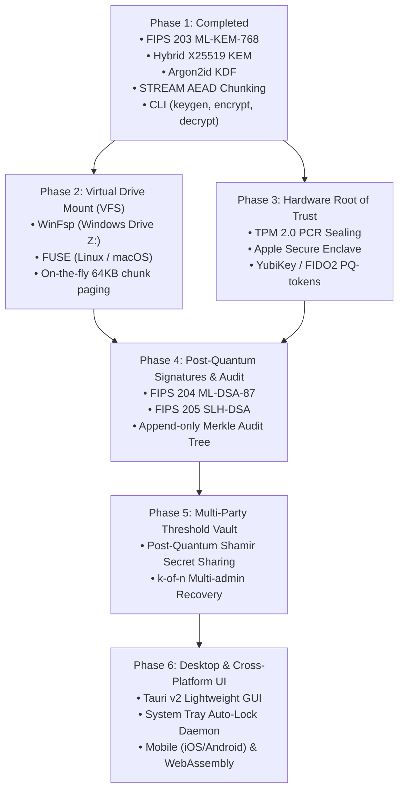

# QSafe: Future Roadmap & Engineering Extensions

This document outlines the architectural roadmap and planned feature extensions for the **QSafe** project. These features build upon the foundation established in Phase 1 (NIST FIPS 203 ML-KEM-768, X25519 Hybrid AEAD, STREAM Chunking, and the CLI).

---

## 🗺️ Roadmap Overview

---

## 1. Virtual Drive Mount Engine (VFS via WinFsp & FUSE)

### Objective
Allow users to mount a `.qsafe` container as a native virtual disk drive (e.g., `Z:\` in Windows Explorer or `/mnt/qsafe` on Linux/macOS) with transparent file access.

### Technical Design
- **Windows Driver:** Use **WinFsp** (Windows File System Proxy) via Rust bindings (`winfsp-rs`).
- **Linux/macOS Driver:** Use **libfuse3** via `fuser` crate.
- **Random-Access Chunk Engine:**
  - Files within the mounted container will be mapped through an indexed virtual allocation table.
  - Read requests for offset $X$ will calculate the chunk index:
    $$\text{ChunkIndex} = \lfloor X / 65536 \rfloor$$
  - The driver decrypts only the specific 64 KB chunk into secure pinned memory, updates the LRU chunk cache, and serves the bytes to the OS kernel without decrypting the entire container.
  - Write requests re-encrypt modified 64 KB chunks in place and update the container's integrity tree.

---

## 2. Hardware Root of Trust Integration (TPM 2.0 & Secure Enclave)

### Objective
Bind private key unlocking to local hardware so that even if the physical disk image is extracted, the private keys cannot be decrypted on another machine.

### Technical Design
- **Windows TPM 2.0 PCR Sealing:**
  - Utilize the Windows TBS (TPM Base Services) API to seal the private key material to specific Platform Configuration Registers (e.g., PCR 0: Firmware, PCR 7: Secure Boot state).
  - Unsealing occurs strictly within TPM hardware only if Secure Boot and UEFI firmware integrity are verified.
- **macOS / iOS Secure Enclave:**
  - Utilize `kSecAccessControlBiometryAny` and `kSecAttrAccessibleAfterFirstUnlockThisDeviceOnly` to store hybrid seed secrets within the hardware Secure Enclave.
- **FIDO2 / Hardware Security Keys:**
  - Support hardware authenticators (YubiKey 5 Series / OpenPGP smartcards) for multi-factor vault unlocking.

---

## 3. Post-Quantum Digital Signatures & Tamper-Proof Audit Logging

### Objective
Add cryptographic non-repudiation and verifiable audit trails for multi-user or enterprise deployments.

### Technical Design
- **Algorithm Implementations:**
  - **FIPS 204 ML-DSA-87** (Module-LWE/SIS lattice signature) for high-speed transaction signing.
  - **FIPS 205 SLH-DSA** (SPHINCS+ stateless hash-based signature) as a conservative algorithmic hedge for long-term root certifications.
- **Merkle Audit Tree:**
  - Every file modification produces an entry in an append-only cryptographic event log.
  - The root of the tree is signed with the user's ML-DSA private key, mathematically proving the timeline of changes and exposing unauthorized rollback attacks.

---

## 4. Multi-Party Threshold Recovery (PQ Shamir Secret Sharing)

### Objective
Protect organizations against single-point-of-failure or key loss by allowing vault recovery only when $k$ out of $n$ authorized keyholders present their shares.

### Technical Design
- **Threshold Scheme:** Implement a $(k, n)$ threshold scheme over Galois Field $GF(2^8)$ or $GF(2^{256})$.
- **Secret Distribution:**
  - The 96-byte hybrid private key (32B X25519 + 64B ML-KEM seed) is split into $n$ polynomial shares.
  - Any $k$ shares can reconstruct the seed via Lagrange interpolation.
  - Shares can be printed as high-density armored paper keys (Base58 / QR codes) or stored across cold USB tokens.

---

## 5. Client-Side WebAssembly (WASM) & Mobile Portability

### Objective
Enable secure, zero-knowledge browser-based decryption and mobile access without exposing private keys to network servers.

### Technical Design
- **WebAssembly Compilation:**
  - Compile `qsafe-core` with `target wasm32-unknown-unknown` and `wasm-bindgen`.
  - Use `WebCrypto API` entropy sources (`crypto.getRandomValues`).
  - Stream large files via `ReadableStream` / `WritableStream` with the same 64 KB STREAM chunk engine.
- **Mobile SDKs (UniFFI):**
  - Generate clean Swift (iOS) and Kotlin (Android) bindings using Mozilla's `uniffi-rs`.

---

## 6. Desktop Application & System Tray Daemon (Tauri v2)

### Objective
Provide a seamless, user-friendly graphical interface for non-technical users.

### Technical Design
- **Framework:** **Tauri v2** with a Rust core backend and a lightweight React/TypeScript frontend.
- **Features:**
  - Inactivity auto-lock timer (automatically zeroizes keys from RAM after $N$ minutes of idle time).
  - Drag-and-drop file and directory encryption.
  - Emergency panic button (immediately zeroizes all unlocked memory buffers and unmounts virtual drives).
  - Clipboard auto-clearing for passphrases after 30 seconds.
